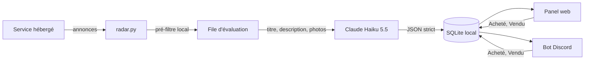

# Repère

Radar local de revente pour Vinted : surveille les marques de vêtements hype et les créateurs, fait évaluer chaque nouvelle annonce par Claude Haiku, affiche les meilleures affaires dans un panel web et les publie dans un serveur Discord avec suivi des achats et des reventes.


[](https://github.com/antoinebrnl/repere-vinted/actions/workflows/tests.yml)

## Sommaire

- [Fonctionnalités](#fonctionnalités)
- [Fonctionnement](#fonctionnement)
- [Installation](#installation)
- [Configuration](#configuration)
- [Bot Discord](#bot-discord)
- [Utilisation](#utilisation)
- [Évaluation par Claude](#évaluation-par-claude)
- [Structure du projet](#structure-du-projet)
- [Tests](#tests)
- [Collecte hébergée](#collecte-hébergée)
- [Distribution](#distribution)
- [Limites](#limites)

## Fonctionnalités

- **Profils vêtements** : liste de marques et de créateurs éditable (Stone Island, CP Company, Arc'teryx, Acne Studios, Maison Margiela, Rick Owens, Raf Simons, Carhartt WIP, Supreme, Stüssy, Ralph Lauren vintage), une recherche par ligne, exclusions de mots-clés (fake, réplique, défaut, taille enfant...). Les filtres RAM ne s'appliquent qu'aux profils RAM, qui restent disponibles.
- **Évaluation par Claude Haiku 5.5** : marque et modèle identifiés, estimation de revente basse, médiane et haute, confiance, risque de contrefaçon, raisons, et multiple de revente. Recherche web pour les comparables quand la confiance est faible, cache par marque et modèle.
- **Page Contemporain** (`/contemporary`) : toutes les offres évaluées, triées par multiple, avec filtres par marque, taille, multiple minimum, confiance et statut, mise à jour automatique.
- **Page Bilan** (`/bilan`) : dépenses, chiffre d'affaires, bénéfice, marge moyenne, courbe cumulée, liste des articles avec boutons Acheté et Vendu.
- **Bot Discord** (optionnel) : un post de forum par offre à partir de 1.5x, une annonce avec ping à partir de 2.2x, boutons Acheté et Vendu avec formulaire, bilan épinglé avec courbe matplotlib, liste des articles achetés.
- **Synchronisation dans les deux sens** : un achat saisi sur Discord apparaît dans le panel, et inversement.
- **Tolérant aux pannes** : si l'API Anthropic ou Discord est indisponible, la collecte continue et les évaluations ou publications en attente sont rejouées plus tard.
- Thèmes clair et sombre, densité, liste ou grille, favoris, historique des prix, export JSON et CSV.

## Fonctionnement



1. La collecte passe par le service hébergé (voir [Collecte hébergée](#collecte-hébergée)).
2. Chaque annonce est comparée gratuitement et localement au profil : marque dans la liste, prix minimal, aucun mot exclu. Seules les annonces retenues entrent dans la file d'évaluation, une seule fois par annonce.
3. Claude renvoie un JSON validé. Le multiple vaut `estimation médiane / (prix + frais de port)` et est recalculé localement, y compris quand le prix baisse.
4. Les offres au-dessus des seuils apparaissent dans le panel, génèrent une alerte et sont publiées sur Discord.

## Installation

Prérequis : Python 3.9 ou plus. Le panel et l'évaluation n'ont aucune dépendance à installer.

```bash
git clone https://github.com/antoinebrnl/repere-vinted.git
cd repere-vinted
python3 radar.py --open
```

Raccourcis de lancement : `Lancer Repere.command` (macOS), `Lancer Repere.bat` (Windows), `sh start.sh` (Linux). Le panel s'ouvre sur http://127.0.0.1:8765.

Dans **Données & connexion**, saisis l'adresse du service hébergé et la clé d'activation fournie par le propriétaire, vérifie l'accès, active le profil **Vêtements de marques** dans **Recherches**, puis démarre la veille.

### Bot Discord (optionnel)

Le bot demande deux paquets supplémentaires. Sans eux, tout le reste fonctionne.

```bash
python3 -m pip install -r requirements.txt
```

## Configuration

Toute la configuration sensible passe par des variables d'environnement. Aucune clé n'est écrite dans `data/`, dans l'état du dashboard ni dans les exports. Les lanceurs ne lisent pas de fichier `.env` : définis les variables dans ton terminal ou dans ton système.

| Variable | Obligatoire | Rôle |
| --- | --- | --- |
| `ANTHROPIC_API_KEY` | pour l'évaluation | Clé de l'API Anthropic. Sans elle, les annonces restent en attente et sont évaluées dès qu'elle est définie. |
| `ANTHROPIC_MODEL` | non | Modèle utilisé. Par défaut `claude-haiku-5-5`. |
| `DISCORD_TOKEN` | pour le bot | Token du bot. Si absent, le bot n'est pas lancé. |
| `DISCORD_GUILD_ID` | pour le bot | Identifiant du serveur. Les clics venant d'un autre serveur sont ignorés. |
| `DISCORD_FORUM_CHANNEL_ID` | pour le bot | Salon forum : un post par offre à partir du seuil du panel. |
| `DISCORD_ALERTS_CHANNEL_ID` | pour le bot | Salon d'annonces : un message avec ping par offre à partir du seuil d'annonce. |
| `DISCORD_BILAN_CHANNEL_ID` | pour le bot | Salon du bilan : message épinglé mis à jour à chaque achat ou vente. |
| `DISCORD_ITEMS_CHANNEL_ID` | non | Salon listant chaque article acheté. Sans lui, un fil « Articles achetés » est créé dans le salon du bilan. |
| `DISCORD_ALERT_ROLE_ID` | non | Rôle pingé pour les annonces. Sans lui, le message utilise `@here`. |

Exemple PowerShell, valable pour la session en cours :

```powershell
$env:ANTHROPIC_API_KEY = "sk-ant-..."
$env:DISCORD_TOKEN = "..."
python radar.py --open
```

Les seuils se règlent dans **Préférences** : 1.5 par défaut pour le panel et les posts de forum, 2.2 par défaut pour les notifications et les annonces.

## Bot Discord

### Création

1. Ouvre le [portail développeur Discord](https://discord.com/developers/applications), crée une application, puis dans **Bot** génère un token : c'est `DISCORD_TOKEN`. Aucun intent privilégié n'est nécessaire.
2. Dans **OAuth2 > URL Generator**, coche le scope `bot` et les permissions listées ci-dessous, puis invite le bot sur ton serveur.
3. Crée un salon forum, un salon textuel d'annonces et un salon textuel de bilan (plus un salon d'articles si tu veux). Active le mode développeur de Discord (Paramètres > Avancés) et copie les identifiants avec un clic droit sur le serveur et sur chaque salon.
4. Définis les variables d'environnement du tableau ci-dessus et lance `python3 radar.py`.

### Permissions du bot

| Permission | Pourquoi |
| --- | --- |
| Voir les salons | Accéder aux salons configurés |
| Envoyer des messages | Annonces, bilan, liste d'articles, création de posts de forum |
| Envoyer des messages dans les fils et posts | Liste d'articles dans un fil |
| Créer des fils publics | Fil « Articles achetés » quand aucun salon d'articles n'est défini |
| Intégrer des liens | Embeds |
| Joindre des fichiers | Image de la courbe du bilan |
| Gérer les messages | Épingler le message du bilan |
| Mentionner @everyone, @here et tous les rôles | Ping des annonces, sauf si le rôle ciblé est mentionnable |

### Fonctionnement

- Chaque post de forum et chaque annonce porte un bouton **Acheté**. Il ouvre un formulaire : prix d'achat réel, prix de revente si déjà revendu, plateforme et frais. Après l'achat, le bouton devient **Vendu**, qui demande le prix de revente.
- Les boutons sont persistants : ils continuent de fonctionner après un redémarrage, car leur identifiant porte l'action et l'annonce.
- Le bot interroge la base locale toutes les 8 secondes environ : les achats saisis dans le panel mettent à jour les messages Discord, et inversement.
- Le bot peut aussi tourner seul, sans le panel : `python3 bot.py`. Ne lance pas les deux modes en même temps avec le même token.

## Utilisation

| Page | Adresse | Contenu |
| --- | --- | --- |
| Annonces | `/` | Flux de collecte, favoris, historique des prix |
| Contemporain | `/contemporary` | Offres évaluées, filtres, boutons Marquer acheté et Marquer vendu |
| Bilan | `/bilan` | Totaux, courbe cumulée, liste des articles |
| Recherches | depuis le menu | Profils RAM, vêtements et libres |
| Préférences | depuis le menu | Apparence, cycle de veille, seuils |

La page Contemporain affiche un badge `1.5x+` ou `2.2x+` selon les seuils configurés. Une offre en attente d'évaluation ou en échec est affichée avec son état et un bouton pour relancer l'évaluation.

Le bénéfice d'un article vendu vaut `prix de vente - prix d'achat - frais`. Le bénéfice cumulé de la courbe ne compte que les articles déjà vendus.

## Évaluation par Claude

- **Pré-filtre local** : marque présente dans la liste, prix minimal, aucun mot exclu. Une annonce ne rentre qu'une fois dans la file.
- **Envoi** : titre, description, marque, état, taille, prix, frais de port et deux photos au maximum. Le contenu de l'annonce est traité comme une donnée non fiable.
- **Réponse** : un objet JSON avec `marque_identifiee`, `modele`, `estimation_revente_basse`, `estimation_revente_mediane`, `estimation_revente_haute`, `confiance`, `risque_contrefacon` et `raisons`. Toute réponse hors format est rejetée et réessayée.
- **Comparables** : quand la confiance est inférieure à 0.6, une seconde requête active l'outil `web_search` de l'API. Les résultats fiables sont mis en cache 14 jours par marque et modèle, ce qui évite de repayer la recherche pour les annonces suivantes.
- **Cadence** : une requête à la fois, avec une pause entre deux appels, et reprise avec délai croissant sur les erreurs 429, 5xx et réseau. Une panne ne consomme pas les essais d'une annonce.
- **Photos refusées** : si l'API ne peut pas récupérer une image, l'évaluation est refaite sans photos.

Le coût dépend du nombre d'annonces retenues par le pré-filtre et des recherches web déclenchées. Surveille ta consommation dans la console Anthropic.

## Structure du projet

```
radar.py            serveur local, profils, collecte, API HTTP
connection.py       client du service hébergé
appraisal.py        client Claude, parsing JSON, cache, file d'évaluation
ledger.py           achats et reventes, totaux, courbe
bridge.py           ce qui doit être publié sur Discord, sans dépendance
bot.py              bot Discord (discord.py), boutons persistants, bilan
static/             interface web (index.html, app.js, offers.js, style.css)
tests/              tests unitaires et tests navigateur optionnels
requirements.txt    dépendances optionnelles du bot
data/               base SQLite et connexion, jamais versionnés
```

## Tests

```bash
python3 -m unittest discover -s tests -v
node --check static/app.js
node --check static/offers.js
python3 radar.py --diagnose
```

Les tests du bot et de la courbe sont ignorés si `discord.py` ou `matplotlib` sont absents. Tests navigateur optionnels : installe `requirements-dev.txt`, puis `python3 -m playwright install chromium`. La CI GitHub couvre Windows, macOS et Linux, le bot et le navigateur. Les tests hors ligne ne prouvent pas que Vinted accepte le collecteur déployé ni qu'une clé Anthropic ou un token Discord réels fonctionnent.

## Collecte hébergée

Le collecteur est un projet séparé, réservé au propriétaire (`../repere-service`). Déploie-le d'abord en suivant son README. Ce client ne contient aucun collecteur Vinted direct et aucun repli si le service refuse l'accès. Remplacer la clé d'activation partagée arrête les nouvelles collectes faites avec l'ancienne clé pour tous les utilisateurs. Les données locales restent disponibles : ce n'est ni une destruction de fichiers ni une garantie contre un logiciel réécrit indépendamment.

Le client stocke la clé d'activation dans `data/connection.json` (permissions réservées au propriétaire sous Unix). Il ne la renvoie ni dans l'état du dashboard ni dans les exports. Ne partage pas `data/`. Tout le monde utilise la même clé : la changer coupe l'accès de tous jusqu'à la saisie de la nouvelle. C'est un contrôle d'accès, pas une protection contre la copie.

## Distribution

Le client est dans le dépôt privé https://github.com/antoinebrnl/repere-vinted. Invite des amis depuis **Settings > Collaborators** et fais-leur accepter l'invitation avant de cloner. Garde privés le projet `repere-service` et la clé d'activation. Ne commite ni ne partage le dossier `data/`.

## Limites

- Les estimations de Claude sont des hypothèses, pas des prix de marché. Elles ne remplacent pas la vérification des photos, des étiquettes et de l'authenticité avant achat. Le risque de contrefaçon affiché est un indicateur.
- Le cache par marque et modèle ne distingue pas l'état ni la taille d'un article.
- Les marges excluent les impôts. Aucun achat ni message vendeur n'est envoyé par l'outil.
- Le client doit rester ouvert pour lancer les recherches. Les notifications du navigateur demandent un onglet ouvert.
